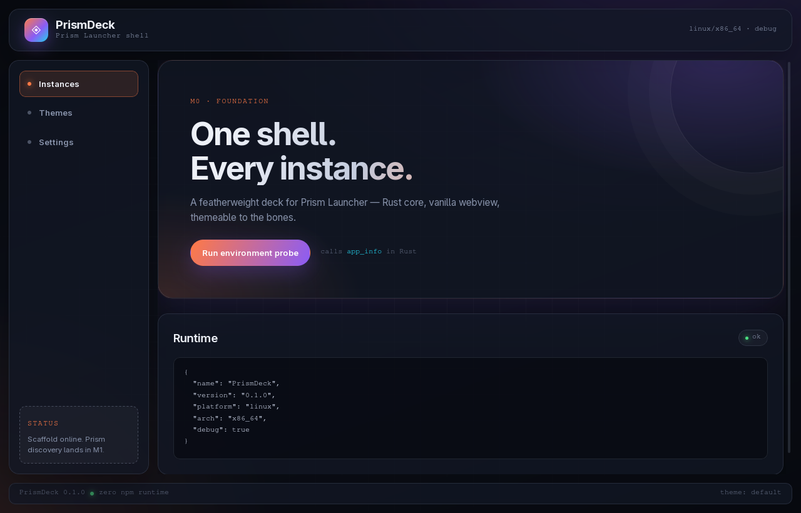

# PrismDeck

> Ultra-light deck shell for [Prism Launcher](https://prismlauncher.org/).
> Rust + Tauri v2 · vanilla JS · one-file CSS themes · Linux & Windows.

**PrismDeck** does not replace Prism Launcher. It discovers your existing
Prism install, reads your instances, launches them through Prism's CLI, and
adds a fast, themeable deck UI on top. Everything that needs the full Prism
GUI (accounts, modpack installers, Java management) is delegated back to
Prism.



## Status

Early development. Current milestone: **M7 — packaging**.

- [x] Tauri v2 + vanilla frontend scaffold
- [x] Prism discovery (native / Flatpak / portable / custom / data-only)
- [x] `instance.cfg` + `mmc-pack.json` + groups parsing + icons
- [x] launch engine with Gamescope / GameMode wrappers
- [x] live stdout/stderr console with stop / force-stop
- [x] instance deck UI (search, group filters, detail modal, onboarding)
- [x] one-file CSS themes + hot reload
- [x] settings persistence (selected install, theme, wrapper, launch options)
- [x] Linux packaging (deb + AppImage)
- [ ] Windows MSI/NSIS packaging

No Prism installed? The app shows onboarding, a manual folder override, and can
load the bundled `fixtures/` demo deck (`PRISMDECK_DEMO=1` auto-loads it in
development).

See `docs/MEMORY.md` for measured memory usage.

## Requirements

- Rust 1.77+ and Cargo
- Tauri v2 prerequisites for your OS
- Linux: `webkit2gtk-4.1` (Arch: `sudo pacman -S webkit2gtk-4.1`)
- Prism Launcher installed if you want to launch instances

## Development

```bash
# one-time: Tauri CLI
cargo install tauri-cli --version '^2' --locked

# run
cargo tauri dev
```

The app is a plain static frontend in `ui/` — no Node.js, no bundler, no
runtime framework. Tauri serves it directly.

## Build

```bash
cargo tauri build
```

Artifacts land in `src-tauri/target/release/bundle/`.

## Project layout

```
src-tauri/   Rust backend (discovery, parsing, launching, theme watcher)
ui/          static HTML/CSS/JS frontend
themes/      single-file CSS themes (loaded at runtime)
docs/        architecture and theming notes
fixtures/    fake Prism data for tests (no Prism install required)
```

## Theming

A theme is **one CSS file** that can re-skin or completely re-arrange the app:
five bundled themes range from a card grid to a terminal-style list to a dock
layout. Edits hot-reload in development.

See `docs/THEMES.md`.

## License

MIT. PrismDeck is unofficial and not affiliated with the Prism Launcher
project. No Prism or Minecraft assets are bundled.
